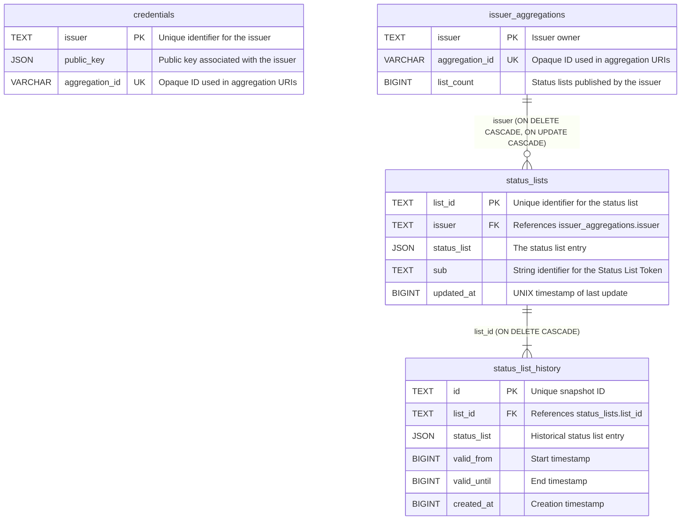

# Database Overview

This document provides an overview of the database schema, including its tables and columns.

Column types are expressed via the sea-orm-migration DSL and map to a
backend-appropriate type per configured `DatabaseBackend` (PostgreSQL, MySQL or
SQLite). Schema identifiers below use the PostgreSQL/TEXT spelling; on other
backends the equivalent native character type is used.

## Tables

### `credentials`

Stores information about issuers and their cryptographic public keys.

| Column           | Type        | Null | Key | Description                                                      |
| ---------------- | ----------- | ---- | --- | ---------------------------------------------------------------- |
| `issuer`         | TEXT        | NO   | PK  | Unique identifier for the issuer                                 |
| `public_key`     | JSON        | NO   |     | Public key associated with the issuer                            |
| `list_count`     | BIGINT      | NO   |     | Legacy counter retained for older release compatibility          |
| `aggregation_id` | VARCHAR(36) | YES  | UQ  | Opaque UUID naming the issuer in public aggregation URIs         |

The legacy `list_count` column remains for compatibility with older releases
during rolling upgrades. Current publishes use `issuer_aggregations.list_count`.

`aggregation_id` is set at registration. It is nullable for the same reason:
pods on the previous release register without one. Such a row gets its ID the
first time it is looked up (`SqlCredentialRepo::find_aggregation_id`), through
an `UPDATE` guarded by `aggregation_id IS NULL` so racing pods agree on one.
The issuer identifier itself never appears in a public URI.

#### Indexes

| Index name                       | Column           |
| -------------------------------- | ---------------- |
| `idx_credentials_aggregation_id` | `aggregation_id` |

### `list_quota`

One row (`id = 1`) that switches `max_lists_per_issuer` on.

| Column     | Type    | Null | Key | Description                                     |
| ---------- | ------- | ---- | --- | ----------------------------------------------- |
| `id`       | INTEGER | NO   | PK  | Always `1`                                      |
| `enforced` | BOOLEAN | NO   |     | Whether publishes respect the quota (default 0) |

A pod turns it on right after migrating a fresh database. On a database the
previous release served, whose pods publish without counting, it stays off until
the operator runs `status-list-server list-quota enable` once none is left, and
pods refuse to start meanwhile unless `limits.list_quota_transition` is set; see
`list_quota.rs`. Publishes read it in their transaction, under a shared lock
while it is off.

### `issuer_aggregations`

The durable issuer ownership and aggregation record. Every issuer has a row,
including issuers with no aggregation ID yet. Registry-only issuers receive
their row together with the immutable aggregation mapping.

| Column           | Type        | Null | Key | Description                                      |
| ---------------- | ----------- | ---- | --- | ------------------------------------------------ |
| `issuer`         | TEXT        | NO   | PK  | Unique issuer identifier and status-list owner   |
| `aggregation_id` | VARCHAR(36) | YES  | UQ  | Public aggregation identifier, when assigned     |
| `list_count`     | BIGINT      | NO   |     | Status lists published; backs the per-issuer quota |

Publishes increment `issuer_aggregations.list_count` transactionally before
inserting into `status_lists`. The status-list owner foreign key references
`issuer_aggregations.issuer`; publishing does not access `credentials`.

### `status_lists`

Stores status list entries and their associated issuer. Each status list is identified
by its `list_id`, which acts as the primary key.

| Column        | Type   | Null | Key | Description                                         |
| ------------- | ------ | ---- | --- | --------------------------------------------------- |
| `list_id`     | TEXT   | NO   | PK  | Unique identifier for the status list               |
| `issuer`      | TEXT   | NO   | FK  | References `issuer_aggregations.issuer` (ON DELETE CASCADE) |
| `status_list` | JSON   | NO   |     | The status list entry                               |
| `sub`         | TEXT   | NO   |     | String identifier for the Status List Token         |
| `updated_at`  | BIGINT | NO   |     | UNIX timestamp of last status update                |

#### Indexes

The following indexes are created on the `status_lists` table to speed up lookups:

| Index name                        | Column            |
| --------------------------------- | ----------------- |
| `idx_status_lists_list_id`        | `list_id`         |
| `idx_status_lists_issuer`         | `issuer`          |
| `idx_status_lists_sub`            | `sub`             |
| `idx_status_lists_issuer_list_id` | `issuer, list_id` |

`idx_status_lists_issuer_list_id` serves issuer-scoped aggregation pages, which
are keyset scans on `list_id` within one issuer. It makes
`idx_status_lists_issuer` redundant. Dropping that is left to a migration of its
own, because on Postgres `DROP INDEX` blocks reads of `status_lists` while it
waits for its lock. On MySQL it backs `fk_status_lists_issuer`, so it can only
be dropped while another index led by `issuer` exists.

### `status_list_history`

Stores historical status list snapshots for time-travel queries.

| Column        | Type   | Null | Key | Description                                           |
| ------------- | ------ | ---- | --- | ----------------------------------------------------- |
| `id`          | TEXT   | NO   | PK  | Unique identifier for the snapshot                    |
| `list_id`     | TEXT   | NO   | FK  | References `status_lists.list_id` (ON DELETE CASCADE) |
| `status_list` | JSON   | NO   |     | The historical status list entry                      |
| `valid_from`  | BIGINT | NO   |     | UNIX timestamp from which this snapshot is valid      |
| `valid_until` | BIGINT | YES  |     | UNIX timestamp until which this snapshot is valid     |
| `created_at`  | BIGINT | NO   |     | UNIX timestamp when snapshot was created              |

#### Indexes

| Index name                          | Column                             |
| ----------------------------------- | ---------------------------------- |
| `idx_status_list_history_list_time` | `list_id, valid_from, valid_until` |

## Migrations are forward-only

Every migration's `down` returns an error, and so do `reset`, `refresh` and
`fresh` (decided in #596). Nothing in production ran `down`, it could not run
to zero on MySQL, and undoing `m20260929_000001_credentials_aggregation_id`
discards aggregation IDs that are already in tokens and issuer metadata.

A release is rolled back by deleting the `seaql_migrations` records of the
migrations it does not know and keeping the schema; upgrading again re-runs
them. The procedure is "Rolling back across migrations" in
`docs/deployment-runbook.md`.

A new migration must therefore:

1. Leave a database the previous release still runs correctly on. In practice
   it is additive: new tables, nullable or defaulted columns, indexes. Say so
   in its row of the runbook's table of migrations safe to leave in place, or
   say what rolling back past it costs.
2. Run again cleanly after its record is deleted, over the schema and data it
   left. Guard each step with `has_column`, `has_index` or `if_not_exists()`,
   and do not overwrite data a first run already wrote.

Tests in `store/tests/migrations.rs` enforce the second rule for every
migration after the four oldest, which predate it. Nothing tests the first; it
rests on review.

## Entity Relationship Diagram

